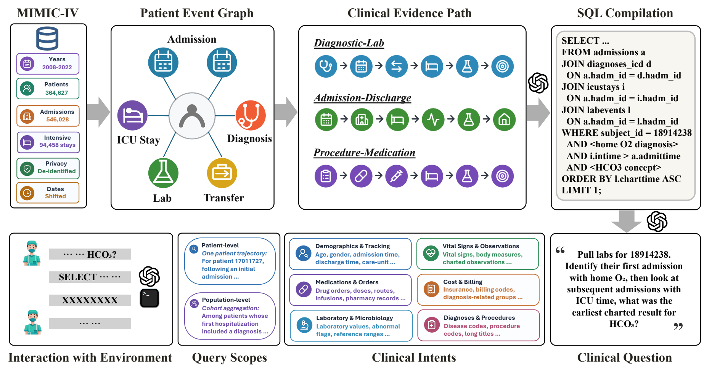
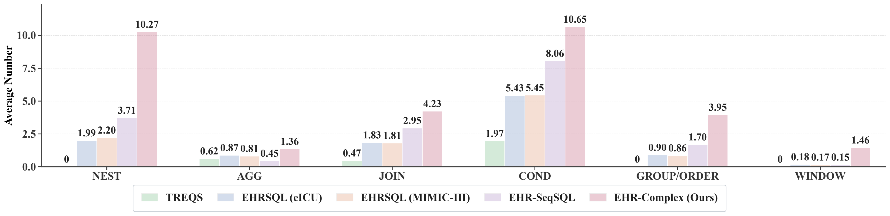
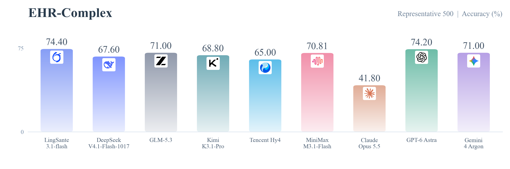

<h1 align="center">EHR-Complex</h1>

<p align="center"><strong>EMNLP 2026 · Oral</strong></p>

<p align="center">Benchmarking Medical Agents for Complex Clinical Reasoning</p>

<p align="center">
  <a href="https://aclanthology.org/2026.emnlp-main.1353/"><strong>Paper</strong></a>
  &nbsp; · &nbsp;
  <a href="https://www.modelscope.cn/datasets/qiaoyitong/EHR-Complex"><strong>Dataset</strong></a>
</p>

---

EHR-Complex evaluates agents that use SQL and Python to answer clinical questions
over MIMIC-IV. This release provides a representative subset of 500 questions
selected by clinical category from the finalized 3,915-question set for fast
evaluation, together with the database builder, evaluation framework, and unified
scorer. The code repository provides the unified scorer; the authorized
ModelScope package provides the questions, reference answers, and field rules it
loads.

The [Full 3,915 evaluation](full_3915/README.md) is also available, using the
complete finalized test set with the same framework and unified scorer. The
Representative 500 workflow below remains the quick-evaluation option.

## Benchmark overview



**From clinical records to executable questions.** Patient event graphs connect
longitudinal evidence into reasoning paths, which are compiled into validated
SQL templates across six clinical intents and two query scopes.



**Reasoning across tables and time.** The paper compares nested queries, joins,
conditions, aggregation, ordering, and window operations across EHR benchmarks.

## Evaluation results

### Representative 500

All models below are evaluated on the same 500-question representative subset.
Scores are accuracy percentages; higher is better.



| Model | Reasoning effort | Accuracy |
| --- | --- | ---: |
| LingSante-3.1-flash | — | 74.40% |
| GPT-6 Astra | `max` | 74.20% |
| GLM-5.3 | `max` | 71.00% |
| Gemini 4 Argon | `high` | 71.00% |
| MiniMax-M3.1-Flash | `max` | 70.81% |
| Kimi-K3.1-Pro | `max` | 68.80% |
| DeepSeek-V4.1-Flash-1017 | `max` | 67.60% |
| Tencent Hy4 | `high` | 65.00% |
| Claude Opus 5.5 | `max` | 41.80% |

Reasoning effort labels are model-specific; — indicates that no separate
effort label is specified.

### Historical subset and full-set comparison

These additional models were evaluated on all **3,915 questions**. The subset
column uses the same runs' saved answers on the released 500 questions, with
the same fixed scorer. Failed tasks and empty submissions count as incorrect.

| Model | Representative 500 | Full 3,915 | Difference (pp) |
| --- | ---: | ---: | ---: |
| Kimi K3 | 68.80% | 68.76% | +0.04 |
| GPT-5.6 Sol | 68.00% | 68.05% | −0.05 |
| GPT-5.4 | 68.00% | 67.92% | +0.08 |
| Gemini 3.1 Pro Preview | 65.40% | 65.47% | −0.07 |
| GLM-5.2 | 63.60% | 63.65% | −0.05 |
| Qwen3.6-27B | 54.40% | 54.33% | +0.07 |

Differences are subset minus full-set accuracy, in percentage points. The
largest absolute difference among these models is about **0.08 percentage
points**. These historical runs were used in subset calibration.

Historical runs used temperature **1**, thinking enabled, a 50-step limit,
and up to 32,768 output tokens per response. Requested reasoning effort was
`max` for Kimi and GLM, `xhigh` for GPT, and `high` for Gemini. Qwen used
`enable_thinking=true` and `preserve_thinking=true`, without a separate effort
setting. `top_p` was 0.95 for Kimi, Gemini, GLM, and Qwen, and omitted for GPT.

## Data access

Access requires a credentialed PhysioNet account, **CITI Data or Specimens Only
Research** training, a signed PhysioNet Data Use Agreement (DUA), and approved
[MIMIC-IV 3.1](https://physionet.org/content/mimiciv/3.1/) access. Download the
hospital and ICU CSVs directly from PhysioNet; we do not distribute the database.

To obtain the Representative 500 or Full 3,915 questions, reference answers,
and scoring annotations:

1. Email either `qiaoyt@zju.edu.cn` or `liulei1497@gmail.com`, preferably
   **sending to one and CC'ing the other**, with the subject
   **EHR-Complex Preprocessed Data Access**. Include your name, institutional
   affiliation, PhysioNet username, and **ModelScope username**. Attach proof of
   approved MIMIC-IV access, completed CITI training, and the signed DUA.
2. After reviewing your documents, we will grant download access directly to
   your ModelScope account and notify you by email. Sign in to that account to
   download the package from
   [ModelScope](https://www.modelscope.cn/datasets/qiaoyitong/EHR-Complex).
   **No separate ModelScope access application is required.**

## Setup

Use Linux x86-64 or AArch64 with Python 3.11 and `unshare` from util-linux.
The host must allow user, mount, PID, IPC, and network namespaces.

```bash
git clone https://github.com/yitong-qiao/EHR-Complex.git
cd EHR-Complex
conda create -n ehrcomplex python=3.11 -y
conda activate ehrcomplex
python -m pip install -r requirements.txt
```

Run the remaining commands from the repository root in this environment. Keep
credentials and downloaded files outside the Python environment directory.

## 1. Convert MIMIC-IV CSVs to DuckDB

Download the full **MIMIC-IV 3.1** hospital and ICU files from
[PhysioNet](https://physionet.org/content/mimiciv/3.1/) with your approved account.
Keep the original directory layout; both `.csv.gz` and uncompressed `.csv` work:

```text
downloads/mimiciv/3.1/
  hosp/*.csv.gz
  icu/*.csv.gz
```

```bash
python database_builder/build_database.py \
  --source ./downloads/mimiciv/3.1 \
  --output ./data/mimic_iv_full.duckdb \
  --threads 8
```

The builder checks all 31 tables, column types, and row counts. The output must
not already exist; allow space for the CSVs, temporary build, and database
(approximately 18 GB). If you choose another output location, set
`EHR_COMPLEX_DB` to its absolute path before evaluation. See
[database preparation](database_builder/README.md) for details.

## 2. Install the 500-question package

For the complete test set, use the [Full 3,915 instructions](full_3915/README.md).
Install one question package per clean checkout; use separate checkouts to
evaluate both packages. They can share the same database via `EHR_COMPLEX_DB`.

After approval, use an [access token](https://www.modelscope.cn/my/myaccesstoken)
from the ModelScope account named in your email:

```bash
python -m pip install modelscope
export MODELSCOPE_API_TOKEN=YOUR_MODELSCOPE_TOKEN
modelscope download --dataset qiaoyitong/EHR-Complex \
  --local_dir ./downloads/ehrcomplex --token "$MODELSCOPE_API_TOKEN"
```

You can also download the files through the website while signed in. Keep this
layout:

```text
downloads/ehrcomplex/
  questions_expected.jsonl
  runtime_index_map.jsonl
  grading/field_contracts.json
```

```bash
python scripts/install_questions.py --source ./downloads/ehrcomplex
```

The installer verifies the question-to-answer mappings and installs 500 tasks
with IDs 0–499. It copies the field rules into `dataset/grading/`, where the
repository's scorer reads them. See [data files](data/README.md) for field definitions.

## 3. Configure a model and run evaluation

```bash
cp credentials.example.toml credentials.toml
```

In `credentials.toml`, replace `OPENAI_API_KEY` and set `OPENAI_BASE_URL` and
`OPENAI_API_BASE` to the same OpenAI-compatible endpoint. Replace
`YOUR_MODEL_NAME` below with the model ID served by that endpoint:

```bash
bash run_benchmark.sh \
  --credentials_path credentials.toml \
  --model_name YOUR_MODEL_NAME \
  --result_dir_tag evaluation_01 \
  --async_run --parallel_backend joblib --n_jobs 32 \
  --temperature 1 --top_p 0.95 --top_k 20 --enable_thinking
```

This runs all 500 questions with concurrency 32, temperature 1, top-p 0.95,
top-k 20, and thinking enabled. Adjust `--n_jobs` for your endpoint; omit
`--top_k` or `--enable_thinking` if unsupported. Defaults are 50 agent steps per
question and 32,768 output tokens per response (`--num_steps` and `--max_new_tokens`).

## 4. Read scores and trajectories

The terminal prints `Success Rate` as accuracy from 0 to 1. Final answers are
compared with reference answers by the [unified scorer](dataset/grading/README.md).
Run summaries are saved in `results/running_records.jsonl`; answers, scores, and
trajectories are saved under:

```text
results/ehr_complex/<run-tag>/test/<scope>/<intent>/<template>/history_<task-id>.json
```

Use a new result tag for each evaluation. Add `--resume` to the same command to
continue an interrupted run. Add `--rescore` to score saved final answers again
and update the existing result files. Reference answers remain outside the
agent's execution environment.

## Citation

```bibtex
@inproceedings{qiao-etal-2026-ehr,
  title={{EHR}-Complex: Benchmarking Medical Agents for Complex Clinical Reasoning},
  author={Qiao, Yitong and Liu, Lei and Shen, Yue and Wang, Jian and Gu, Jinjie and Chu, Zhixuan and Ren, Kui},
  booktitle={Proceedings of the 2026 Conference on Empirical Methods in Natural Language Processing},
  year={2026},
  address={Budapest, Hungary},
  publisher={Association for Computational Linguistics},
  pages={30828--30852},
  doi={10.18653/2026.emnlp-main.1353},
  url={https://aclanthology.org/2026.emnlp-main.1353/}
}
```

## License

Original EHR-Complex code is licensed under [MIT](LICENSE). Third-party code
retains its separate terms; see [third-party notices](THIRD_PARTY_NOTICES.md).

The questions and reference answers are subject to the
[PhysioNet Credentialed Health Data License 1.5.0](https://physionet.org/content/mimiciv/view-license/3.1/)
and the corresponding [DUA](https://physionet.org/content/mimiciv/view-dua/3.1/).
See [data access](#data-access) for eligibility and application requirements.
